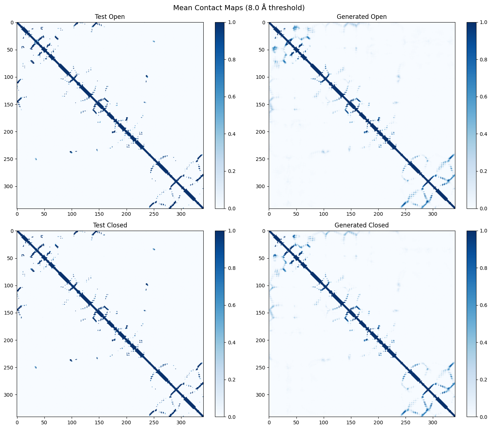
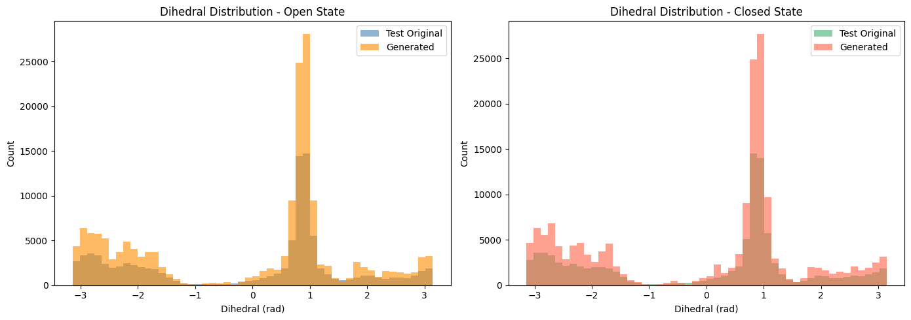
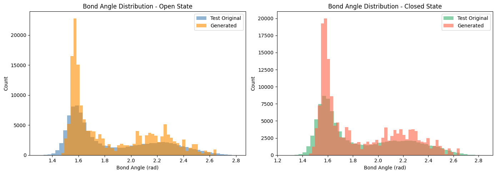
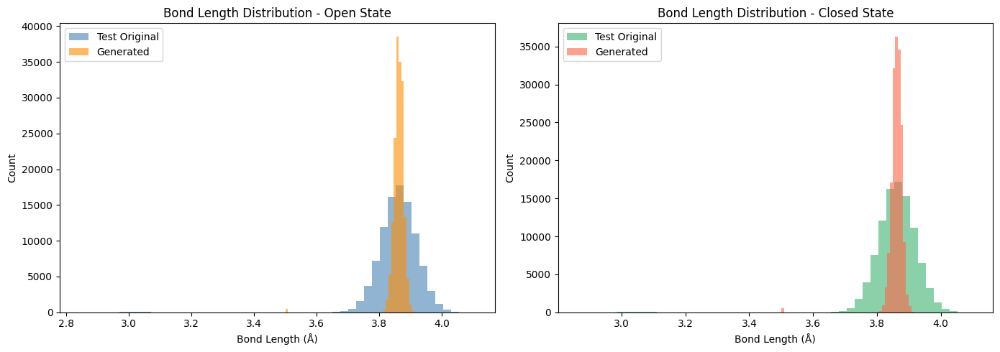
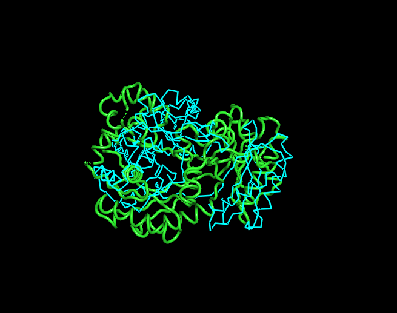

# Protein Conformation Generation using Geometry-Aware Variational Autoencoders
## Overview

This project explores deep generative modeling of protein conformational ensembles using Variational Autoencoders (VAEs). The model learns latent structural representations of proteins and generates physically plausible conformations through geometry-aware constraints and internal-coordinate reconstruction.

The pipeline combines:

* Variational Autoencoders
* Internal-coordinate protein representation
* NeRF-based Cartesian reconstruction
* Distance-map regularization
* Contact-map analysis
* Structural evaluation metrics

The primary objective is to generate realistic protein conformations while preserving global fold topology and local geometric consistency.

## Model Architecture

- Encoder: Multi-layer Variational Encoder
- Latent Space: Gaussian latent manifold
- Decoder: Geometry-aware decoder for internal-coordinate reconstruction
- Reconstruction: NeRF-based Cartesian reconstruction
- Regularization:
  - KL divergence
  - Distance-map loss
  - Radius-of-gyration loss
  - Contact-map constraints

## Results

### Prior Sampling RMSD

| State | RMSD |
|---|---|
| Open | 2.33 Å |
| Closed | 3.33 Å |

## Contact Map Comparison

---

## Geometry Distribution Analysis

### Dihedral Distributions

### Bond Angle Distributions

### Bond Length Distributions

---

## PyMOL Structural Alignment

## Tech Stack

- Python
- PyTorch
- NumPy
- Matplotlib
- PyMOL

## Future Improvements

- Residual CNN decoder
- Equivariant architectures
- Diffusion-based conformational generation

---

## SE(3)-Equivariant Conditional Variational Autoencoder (SE(3)-CVAE)

### Overview

This project explores an SE(3)-equivariant Conditional Variational Autoencoder for protein conformational generation using T4 Lysozyme (T4L) molecular dynamics ensembles.

The model learns latent representations of protein conformations and generates 3D Cα coordinate structures conditioned on the conformational state (Open or Closed).

### Notebook

| Notebook | Description |
|---|---|
| `02_Protein_SE3_CVAE_T4L.ipynb` | SE(3)-equivariant conditional VAE for T4 Lysozyme conformational generation |

### Model Architecture

The SE(3)-CVAE consists of:

- **SE(3)-invariant Encoder:** Learns rotation- and translation-invariant latent representations using local geometric features and graph-based message passing.
- **SE(3)-equivariant Decoder:** Generates 3D protein coordinates through equivariant geometric coordinate updates.
- **Conditional Generation:** Uses Open and Closed conformational state labels.
- **Chirality-aware Geometric Modeling:** Incorporates a cross-product-based pseudo-vector term to distinguish mirror-image configurations.

### Key Features

- Cα-based protein representation.
- Spatial k-nearest-neighbour graph construction.
- Radial basis function (RBF) distance embeddings.
- Local geometric features using residue separation distances.
- SE(3) rotation and translation augmentation.
- Kabsch-aligned reconstruction loss.
- KL annealing and free-bits regularization.
- Geometry-aware structural constraints.

### Training Configuration

| Parameter | Value |
|---|---:|
| Protein system | T4 Lysozyme |
| Cα atoms | 162 |
| Latent dimension | 64 |
| Hidden dimension | 128 |
| Encoder layers | 4 |
| Decoder layers | 4 |
| Spatial neighbours | 16 |
| Batch size | Defined in notebook |
| Maximum epochs | 150 |
| Optimizer | Adam |
| Learning rate | 0.0003 |

### Evaluation

The implementation includes the following evaluation and diagnostic procedures:

- Kabsch-aligned RMSD
- Pairwise distance distributions
- Contact-map F1 score
- Radius of gyration
- Bond-length and bond-angle distributions
- Dihedral-angle distributions
- RMSF analysis
- Latent-space diagnostics
- PCA-based conformational landscape analysis
- Generated-structure novelty analysis
- Posterior collapse diagnostics

Numerical tests are also included to assess encoder invariance, decoder equivariance and chirality sensitivity.

### Dataset Requirements

The notebook expects two PDB trajectory files:

- `trainca_open.pdb`
- `trainca_close.pdb`

Each structure must contain 162 corresponding Cα atoms.

The dataset is not included in this repository. Configure the PDB file paths according to your local environment or Google Drive.

### Running the Notebook

The notebook was developed for Google Colab.

1. Open `02_Protein_SE3_CVAE_T4L.ipynb`.
2. Configure the dataset paths.
3. Mount Google Drive if using Colab.
4. Install the required dependencies.
5. Execute the notebook cells sequentially.

### Dependencies

- Python
- PyTorch
- NumPy
- MDTraj
- Scikit-learn
- Matplotlib

### Research Status

This implementation is an ongoing research experiment exploring geometric deep learning and equivariant generative models for protein conformational ensembles.

Further experiments will investigate geometric representations, latent-space properties, conformational diversity and structural validity.

## Author

Vikash Kumar Mahato

### Research Interests
- Generative AI for proteins
- Computational biology
- Deep learning
- Protein structure modeling